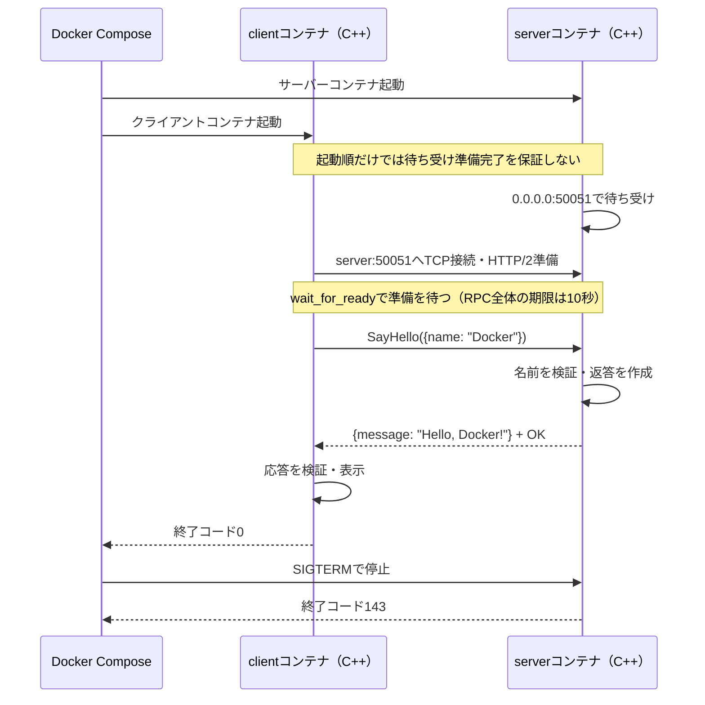

# gRPCの通信と仮想化の基礎

この教材の通信シーケンスと、会話で整理したUDS・VSOCK・TCP、VM・ホストの違いをまとめます。
本リポジトリで実装・検証したのはTCPによるgRPC通信です。UDS・VSOCKは概念の説明です。

## 1. この教材の通信経路

```text
C++クライアント → gRPC / HTTP/2 → TCP → Composeネットワーク → C++サーバー
```

- サーバーは `0.0.0.0:50051` で待ち受けます。
- クライアントはComposeのDNS名 `server` を使い、`server:50051` に接続します。
- `0.0.0.0` は全IPv4インターフェースで待ち受ける指定で、クライアントの接続先ではありません。
- ポートはホストへ公開していません。TLS・認証を省略したローカル学習用です。
- `127.0.0.1` は各コンテナ自身を指します。

`.proto` はRPCとメッセージの契約です。生成されたStubをクライアントが呼び、
サーバーが生成されたServiceを実装します。メッセージはProtocol Buffersでシリアライズされます。
今回はリクエスト1件に応答1件を返すUnary RPCです。

## 2. 起動から終了までのシーケンス

次の起動コマンドを実行した場合です。

```sh
docker compose up --build --abort-on-container-exit --exit-code-from client
```



実際の待ち受け開始とクライアント起動のタイミングは前後し得ます。
クライアントはRPC呼び出し前に10秒の期限と `wait_for_ready` を設定します。
接続準備から応答までを含めて期限が適用されます。

| ログ | 意味 |
| --- | --- |
| `Listening on 0.0.0.0:50051` | サーバーが待ち受けを開始 |
| `SayHello: Docker` | サーバーが正常なリクエストを処理 |
| `Hello, Docker!` | クライアントが期待する応答を受信 |
| `client ... code 0` | クライアント正常終了 |
| `server ... code 143` | Composeの停止要求によるSIGTERM終了（128 + 15）。この実行では想定どおり |

`--abort-on-container-exit` により、クライアントが終了するとサーバーも停止します。
`--exit-code-from client` により、Composeコマンドはクライアントの終了コードを返します。
空の名前は `INVALID_ARGUMENT`（3）、接続できず期限を迎えると `DEADLINE_EXCEEDED`（4）です。

## 3. UDS・VSOCK・TCPソケットの違い

ソケットはプログラムの通信の接続口です。UDS・VSOCK・TCPソケットはその種類です。
「SOCK」単体では方式を特定できません。

| 種類 | 主な通信相手 | 接続先の指定 | IPネットワーク |
| --- | --- | --- | --- |
| UDS（Unix Domain Socket） | 同じOSカーネル上のプロセス | ファイルシステムのパスなど | 不要 |
| VSOCK（Virtual Socket） | ゲストVMとそのホスト | CID + ポート | 不要 |
| TCPソケット | 同じマシン・別マシンのプロセス | IPアドレス + ポート | 使用 |

### UDS

ローカルのプロセス間通信に使います。例えば `/sockets/greeter.sock` という
ソケットのパスに接続します。`.sock` は慣習的な拡張子で、通信内容を保存するファイルではありません。
Linuxにはファイルパスを使わない抽象名前空間のUDSもあります。

別コンテナでも同じカーネル上で動いていれば、共有ボリュームでソケットのパスを共有し、
権限を整えることでパス型UDSを利用できます。別ホスト間へパスを共有するだけでは使えません。
gRPCでの接続先表現の例は `unix:/sockets/greeter.sock` です。

### VSOCK

主に仮想マシンとそのホストの通信に使います。CIDはVMやホストなどを識別し、
ポートはそこで動くサービスを識別します。IPアドレスやVMのネットワーク設定に依存しません。

利用にはカーネル・仮想化基盤側の対応が必要です。コンテナを作るだけでVSOCKが使えるわけではありません。
また、gRPCライブラリから直接使えるかは、言語・実装・バージョンなどの確認が必要です。
本教材ではVSOCK対応を実装・検証していません。

### TCPとSOCK_STREAM

低レベルのC/C++ APIでは、通信先の種類と通信の性質を別々に指定します。
次はソケット作成の概念例であり、接続処理を含む完成プログラムではありません。

```cpp
socket(AF_UNIX,  SOCK_STREAM, 0); // UDS
socket(AF_VSOCK, SOCK_STREAM, 0); // VSOCK
socket(AF_INET,  SOCK_STREAM, 0); // IPv4のTCP
```

`AF_*` が通信先の種類、`SOCK_STREAM` が順序を保証するバイト列通信という性質です。
`SOCK_STREAM` 自体がTCPという意味ではありません。
`AF_INET6` はIPv6用です。また、`SOCKS` はプロキシのプロトコルで、これらとは別の用語です。

## 4. ホストとゲストVMとは

ホストはVMを動かす側、ゲストVMは独立したOS・カーネルを持つ仮想的なコンピューターです。
ハイパーバイザーはCPUやメモリーなどを仮想化し、VMの実行を管理します。
ホスト・ゲストは相対的な呼び方で、ホスト側にデスクトップOSがあるとは限りません。

| 構成例 | ホスト側 | ゲストVM側 | 主な用途 |
| --- | --- | --- | --- |
| Mac上でLinux | Mac / macOSと仮想化基盤 | Linux | Linux開発環境 |
| Mac上でWindows | Mac / macOSと仮想化基盤 | Windows（CPU構成に対応するもの） | Windowsアプリの利用 |
| Windows上でLinux | Windowsと仮想化基盤 | Linux | Linux開発環境 |
| Linux上で別のLinux | Linux / KVMなど | Linux | 分離・検証 |
| クラウドの仮想サーバー | 事業者の物理サーバーと仮想化基盤 | 利用者のLinux / Windows | アプリやサーバーの実行 |
| 専用仮想化サーバー | ハードウェア上のハイパーバイザー | 複数のLinux / Windows | サーバー集約 |

これらは構成パターンの例です。全環境でVSOCKが提供されるという意味ではありません。

### LinuxホストでDockerを使う場合

```text
物理マシン
└─ Linuxホスト
   ├─ Linuxカーネル
   ├─ serverコンテナ ─┐
   └─ clientコンテナ ─┴─ ホストのLinuxカーネルを共有
```

通常のコンテナは独立したカーネルを持たず、ホストのカーネルを共有します。
コンテナ間のTCP通信に、必ずVMの境界があるわけではありません。

### MacでDocker DesktopのLinuxコンテナを使う場合

```text
物理的なMac
└─ macOS                         ← Linux VMに対するホスト側
   └─ 仮想化基盤
      └─ Linux VM                ← ゲストVM・コンテナの実行ホスト
         ├─ Linuxカーネル
         ├─ serverコンテナ ─┐
         └─ clientコンテナ ─┴─ Linux VMのカーネルを共有
```

これは代表的な概念構成です。この開発マシンで実際に使用中のDockerバックエンドや
仮想化方式までは調査していません。

| 通信区間 | 方式との関係 |
| --- | --- |
| serverコンテナ ↔ clientコンテナ | 本教材はTCP。ソケットパスを共有するUDSも候補 |
| macOS側プロセス ↔ Linux VM側プロセス | VSOCKが対象とする境界。ただし対応する仮想化基盤と実装が必要 |
| 別の物理マシン同士 | 通常はTCP/IP |

コンテナ間通信だからVSOCKになるのではなく、どの境界を越える通信かで考えます。

## 5. 参考資料

- [gRPC C++ Quick start](https://grpc.io/docs/languages/cpp/quickstart/)
- [Composeの起動順制御](https://docs.docker.com/compose/how-tos/startup-order/)
- [socket(2): 通信ドメインとソケット型](https://man7.org/linux/man-pages/man2/socket.2.html)
- [unix(7): Unix domain socket](https://man7.org/linux/man-pages/man7/unix.7.html)
- [vsock(7): VSOCKの用途とアドレス形式](https://man7.org/linux/man-pages/man7/vsock.7.html)
