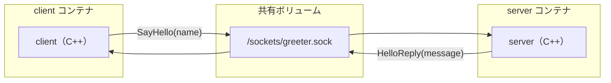
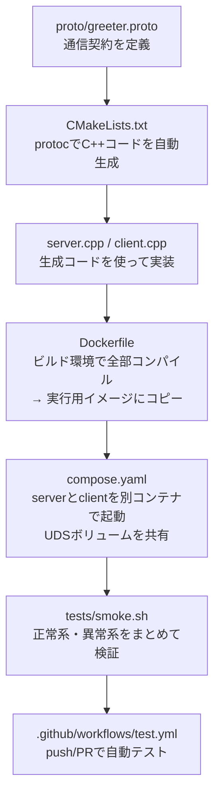
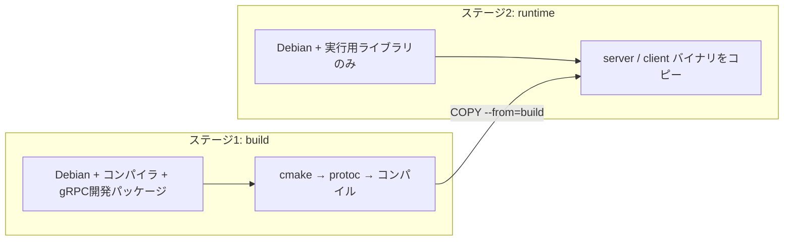

# gRPCStudy プロジェクト 理解のポイント

> [!NOTE]
> このドキュメントは、他の人にプロジェクトを説明するための「理解ガイド」です。
> 技術的な正確さと、説明しやすさのバランスを意識しています。

---

## 1. このプロジェクトは何か（一言で）

**「Dockerコンテナ間でgRPC通信する最小構成のC++学習環境」**

名前を送ると「Hello, ○○!」と返してくれる、たった1つのRPC（リモートプロシージャコール）を、2つのDockerコンテナ間で動かしています。

---

## 2. 全体像（まずこれを掴む）



### ポイント
- **TCP/IPを使っていない**。2つのコンテナは `network_mode: none`（ネットワーク無効）
- 代わりに **UDS（Unix Domain Socket）** というファイルシステム上のソケットで通信
- 共有ボリューム `/sockets` にソケットファイルを置き、両コンテナがアクセスする

---

## 3. 理解の鍵となる3つのコンセプト

### 🔑 コンセプト① — gRPCの通信契約（Protocol Buffers）

```text
proto/greeter.proto  ←  「何を送って何を受け取るか」の契約書
```

- **サービス定義**: `SayHello` というRPCメソッドが1つだけ
- **入力**: `HelloRequest`（name フィールド）
- **出力**: `HelloReply`（message フィールド）
- この `.proto` ファイルからC++のコードが**自動生成**される
- 生成されたコードが通信のシリアライズ／デシリアライズを全部やってくれる

> 📝 **説明するときのコツ**: 「APIの仕様書を書くと、通信コードが自動で作られる仕組み」と伝えると分かりやすい

### 🔑 コンセプト② — サーバーとクライアントの役割分担

| | サーバー（[server.cpp](../src/server.cpp)） | クライアント（[client.cpp](../src/client.cpp)） |
|---|---|---|
| 役割 | リクエストを待って処理する | リクエストを送って結果を受け取る |
| やること | 生成された`Service`を**継承**してロジックを実装 | 生成された`Stub`を使ってRPCを**呼び出す** |
| 入力チェック | 空文字は`INVALID_ARGUMENT`で拒否 | RPC失敗は終了コード1で通知 |
| 待ち方 | `server->Wait()` で待ち続ける | `wait_for_ready`＋10秒期限で接続を待つ |

### 🔑 コンセプト③ — UDS（Unix Domain Socket）の意味

| 通常のgRPC（TCP） | このプロジェクト（UDS） |
|---|---|
| `localhost:50051` など | `unix:/sockets/greeter.sock` |
| IPネットワーク経由 | ファイルシステム経由（カーネル内で完結） |
| ネットワーク権限が必要 | ファイルの権限で制御可能 |

> 📝 **なぜUDSなのか**: 同じマシン（やDocker環境）内の通信では、TCP/IPのオーバーヘッドがなく高速。セキュリティもファイル権限で制御しやすい。

---

## 4. ファイルの処理フロー（ビルドから実行まで）



### 各段階の要点

| 段階 | ファイル | 一言で |
|---|---|---|
| ① 契約定義 | [`greeter.proto`](../proto/greeter.proto) | 送受信の型を決める（API仕様書） |
| ② ビルド設定 | [`CMakeLists.txt`](../CMakeLists.txt) | protocで自動生成 → コンパイル |
| ③ ロジック実装 | [`server.cpp`](../src/server.cpp) / [`client.cpp`](../src/client.cpp) | 生成コードの上にビジネスロジックを書く |
| ④ コンテナ化 | [`Dockerfile`](../Dockerfile) | マルチステージビルド（ビルド用→実行用） |
| ⑤ 構成管理 | [`compose.yaml`](../compose.yaml) | 2コンテナ＋共有UDSボリューム |
| ⑥ テスト | [`smoke.sh`](../tests/smoke.sh) | 正常・再起動・空入力・接続不能の4パターン |
| ⑦ CI | [`test.yml`](../.github/workflows/test.yml) | push/PRごとに自動実行 |

---

## 5. Dockerfileの設計ポイント（マルチステージビルド）



- **ビルドツール（コンパイラ等）は実行イメージに含まれない** → イメージサイズが小さい
- 非rootユーザー（UID 10001）で実行 → セキュリティの基本
- `/sockets` ディレクトリの所有権を設定 → UDSの権限管理

---

## 6. compose.yaml の設計ポイント

```yaml
# 理解すべき3つの設計判断
network_mode: none        # ① IPネットワークを完全に無効化
volumes: [sockets:/sockets]  # ② UDS共有ボリュームのみで通信
depends_on: [server]      # ③ 起動順序の保証（でも準備完了は保証しない）
```

- `server` と `client` は**同一イメージ**（`grpc-study:local`）から起動
- `command` で実行ファイル（server / client）を切り替え
- `client` の `pull_policy: never` → ローカルビルド済みイメージのみ使用

---

## 7. テスト戦略（smoke.sh が検証する5項目）

| # | テスト内容 | 検証するもの |
|---|---|---|
| 1 | `Hello, Docker!` の正常受信 | UDS経由のgRPC通信が動くこと |
| 2 | server再起動後の再接続 | ソケット再作成と再接続 |
| 3 | ソケットファイルの存在確認 | UDSが通常ファイルでなくソケットであること |
| 4 | 空文字入力 → エラーコード3 | サーバー側の入力バリデーション |
| 5 | 存在しないソケット → エラーコード4 | クライアントのタイムアウト処理 |

> [!IMPORTANT]
> 正常系だけでなく**異常系（入力エラー・接続不能）** も自動検証している点が、学習環境としてのポイントです。

---

## 8. 人に説明するときの「ストーリー」

以下の順序で説明すると伝わりやすいです：

### ステップ1: 「何をするプロジェクトか」
> 「2つのDockerコンテナの間で、名前を送ると挨拶が返ってくる最小のgRPC通信を動かす学習環境です」

### ステップ2: 「gRPCの仕組み」
> 「まず `.proto` ファイルに "どんなデータをやり取りするか" を定義します。するとC++の通信コードが自動生成されるので、開発者はビジネスロジックだけ書けばいいんです」

### ステップ3: 「特徴的なポイント = UDS」
> 「普通はTCP/IPで通信しますが、このプロジェクトではUnix Domain Socketを使っています。同じマシン上ならファイルシステム経由で通信でき、ネットワークを完全に無効化してもコンテナ間で通信できることを実証しています」

### ステップ4: 「開発プロセスの完結性」
> 「Dockerfileでビルド環境もパッケージされているので、ホストにC++やgRPCをインストールする必要がありません。`docker compose up --build` だけで全部動きます。GitHub Actionsで自動テストも回っています」

---

## 9. よくある質問（FAQ）

| 質問 | 回答 |
|---|---|
| なぜC++？ | gRPCのリファレンス実装言語。低レベルの制御を学べる |
| なぜUDSでTCPじゃない？ | 同一ホスト通信の実践パターン。セキュリティと性能の両面で利点 |
| 認証・TLSは？ | 学習用のため省略。本番利用時は別途設計が必要 |
| Apple Siliconで動く？ | 動く。Dockerがネイティブにビルドする |
| ストリーミングRPCは？ | 対象外。Unary RPC（1リクエスト1応答）のみ |
| 生成コードはGitに入ってる？ | 入っていない。ビルド時に毎回生成される |

---

## 10. プロジェクト構成の一覧

```text
gRPCStudy/
├── proto/greeter.proto          # ① 通信契約（ここから始める）
├── src/
│   ├── server.cpp               # ② サーバー実装
│   └── client.cpp               # ③ クライアント実装
├── CMakeLists.txt               # ④ C++ビルド設定（proto自動生成含む）
├── Dockerfile                   # ⑤ マルチステージビルド
├── compose.yaml                 # ⑥ 2コンテナ＋UDSボリューム構成
├── tests/smoke.sh               # ⑦ 正常・異常系テスト
├── .github/workflows/test.yml   # ⑧ CI（push/PRで自動実行）
├── .dockerignore                # ビルドに送るファイルを制限
├── .gitignore                   # 生成物をGit除外
├── README.md                    # 使い方の全体案内
└── docs/
    ├── file-guide.md            # 各ファイルの詳細説明
    └── communication-and-virtualization.md  # 通信方式の比較
```

> [!TIP]
> 読む順序は **① proto → ② server → ③ client → ④ CMake → ⑤ Docker → ⑥ Compose** がおすすめです。通信の「契約→実装→ビルド→デプロイ」の流れに沿っています。
