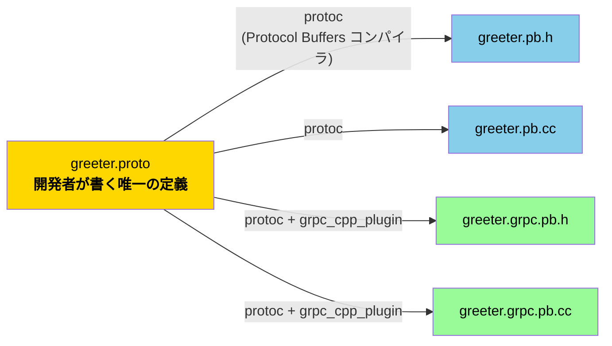
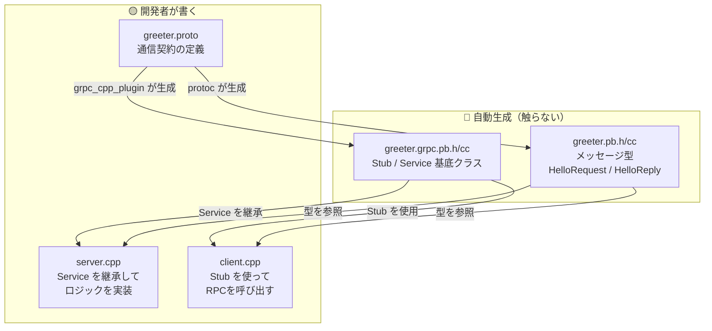
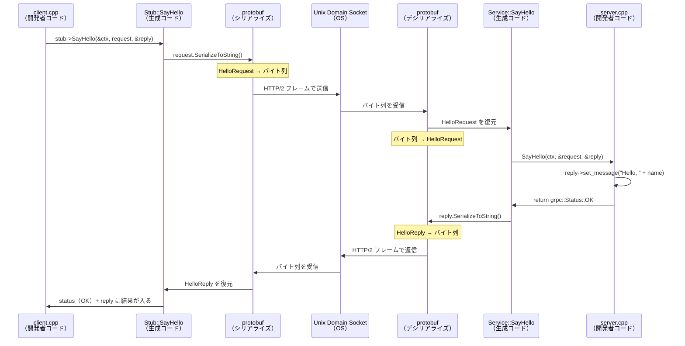

# proto → 生成コード 完全マッピングガイド

> [!NOTE]
> `.proto` ファイルに書いた定義が、どんなC++コードになり、server/client でどう使われるかを追える資料です。

---

## 1. 生成の全体像 — 1つの `.proto` から4つのファイルが生まれる



| 生成ファイル | 生成ツール | 中身 | 行数 |
|---|---|---|---|
| `greeter.pb.h` / `.cc` | `protoc` 本体 | **メッセージ型**（データの器） | 約460行 |
| `greeter.grpc.pb.h` / `.cc` | `protoc` + `grpc_cpp_plugin` | **Service / Stub**（通信の口） | 約310行 |

> [!IMPORTANT]
> 開発者が書いたのは **16行の `.proto`** だけ。そこから **約770行のC++** が自動生成されます。通信のシリアライズ・デシリアライズ・RPCの配線はすべて生成コードが担当します。

---

## 2. proto定義と生成コードの1対1マッピング

### 2.1 `package study;` → C++ 名前空間

````carousel
```protobuf
// proto で書いたもの
package study;
```
<!-- slide -->
```cpp
// 生成されたC++
namespace study {
  class HelloRequest ...;
  class HelloReply ...;
  class Greeter ...;
}  // namespace study
```
````

`package` は C++ の `namespace` に直接対応します。`study::HelloRequest` のように使います。

---

### 2.2 `message HelloRequest { string name = 1; }` → C++ クラス

````carousel
```protobuf
// proto で書いたもの
message HelloRequest {
  string name = 1;   // 「= 1」はフィールド番号（初期値ではない）
}
```
<!-- slide -->
```cpp
// greeter.pb.h に生成されたもの（主要部分を抜粋）
class HelloRequest final : public ::google::protobuf::Message {
 public:
  // --- 開発者が使うAPI ---

  // name を読み取る
  const std::string& name() const;

  // name を設定する
  void set_name(const std::string& value);

  // name をクリアする
  void clear_name();

  // --- 内部（自動で使われる） ---
  // シリアライズ（C++オブジェクト → バイト列）
  bool SerializeToString(std::string* output) const;
  // デシリアライズ（バイト列 → C++オブジェクト）
  bool ParseFromString(const std::string& data);
};
```
````

### 2.3 `message HelloReply { string message = 1; }` → C++ クラス

````carousel
```protobuf
// proto で書いたもの
message HelloReply {
  string message = 1;
}
```
<!-- slide -->
```cpp
// greeter.pb.h に生成されたもの（主要部分を抜粋）
class HelloReply final : public ::google::protobuf::Message {
 public:
  // message を読み取る
  const std::string& message() const;

  // message を設定する
  void set_message(const std::string& value);

  // message をクリアする
  void clear_message();
};
```
````

### フィールド型の対応表

| proto の型 | C++ の型 | getter | setter |
|---|---|---|---|
| `string` | `std::string` | `name()` | `set_name("値")` |
| `int32` | `int32_t` | `id()` | `set_id(42)` |
| `bool` | `bool` | `active()` | `set_active(true)` |
| `bytes` | `std::string` | `data()` | `set_data(bytes)` |

> 📝 **命名規則**: proto の `snake_case` フィールド名がそのまま C++ のメソッド名になる

---

### 2.4 `service Greeter { rpc SayHello ... }` → Stub（クライアント用）＋ Service（サーバー用）

これが **gRPC ならではの生成** です。`protoc` 本体ではなく `grpc_cpp_plugin` が担当します。

````carousel
```protobuf
// proto で書いたもの
service Greeter {
  rpc SayHello (HelloRequest) returns (HelloReply);
}
```
<!-- slide -->
```cpp
// greeter.grpc.pb.h に生成されたもの

class Greeter final {
 public:

  // ========================================
  // 【クライアント用】 Stub
  // ========================================
  class Stub final : public StubInterface {
   public:
    // チャネル（接続先）からStubを作る
    Stub(const std::shared_ptr<grpc::ChannelInterface>& channel, ...);

    // 同期RPC呼び出し — client.cpp がこれを使う
    grpc::Status SayHello(grpc::ClientContext* context,
                          const study::HelloRequest& request,
                          study::HelloReply* response) override;
  };

  // Stubのファクトリメソッド
  static std::unique_ptr<Stub> NewStub(
      const std::shared_ptr<grpc::ChannelInterface>& channel, ...);

  // ========================================
  // 【サーバー用】 Service（基底クラス）
  // ========================================
  class Service : public grpc::Service {
   public:
    // server.cpp がこれをオーバーライドして実装する
    virtual grpc::Status SayHello(grpc::ServerContext* context,
                                  const study::HelloRequest* request,
                                  study::HelloReply* response);
  };
};
```
````

> [!TIP]
> `service` 1つにつき **Stub（クライアントの呼び出し口）** と **Service（サーバーの実装ベース）** の2つが生成されるのが gRPC の核心です。

---

## 3. 生成コードと手書きコードの境界



---

## 4. server.cpp はどう使っているか

```cpp
// server.cpp — 生成された Service を「継承」してロジックを実装する

// ① 生成 Service の継承
class Greeter final : public study::Greeter::Service {
                              //  ^^^^^^^^^^^^^^^^
                              //  greeter.grpc.pb.h で生成された基底クラス

  // ② 生成された仮想メソッドをオーバーライド
  grpc::Status SayHello(
      grpc::ServerContext*,
      const study::HelloRequest* request,   // ← greeter.pb.h で生成された型
      study::HelloReply* reply              // ← greeter.pb.h で生成された型
  ) override {

    // ③ 生成メソッドで入力を読む
    if (request->name().empty()) {   // .name() は proto の string name = 1 から生成
      return {grpc::StatusCode::INVALID_ARGUMENT, "name must not be empty"};
    }

    // ④ 生成メソッドで出力を設定する
    reply->set_message("Hello, " + request->name() + "!");
    //     ^^^^^^^^^^^^  .set_message() は proto の string message = 1 から生成

    return grpc::Status::OK;
    // → gRPC フレームワークが reply をシリアライズして送信
  }
};
```

| 行 | proto との対応 |
|---|---|
| `study::Greeter::Service` | `service Greeter` から生成 |
| `SayHello(...)` | `rpc SayHello` から生成 |
| `study::HelloRequest*` | `message HelloRequest` から生成 |
| `study::HelloReply*` | `message HelloReply` から生成 |
| `request->name()` | `string name = 1` から生成 |
| `reply->set_message(...)` | `string message = 1` から生成 |

---

## 5. client.cpp はどう使っているか

```cpp
// client.cpp — 生成された Stub を「使って」RPCを呼び出す

// ① Stub を生成するファクトリメソッド
auto stub = study::Greeter::NewStub(
//          ^^^^^^^^^^^^^^^^^^^^^
//          greeter.grpc.pb.h で生成されたファクトリ
    grpc::CreateChannel(target, grpc::InsecureChannelCredentials()));

// ② 生成されたメッセージ型で入力を準備
study::HelloRequest request;    // greeter.pb.h の生成クラス
request.set_name(name);         // proto の string name = 1 → set_name()

study::HelloReply reply;        // greeter.pb.h の生成クラス
grpc::ClientContext context;

// ③ 生成された Stub のメソッドでRPC実行
const auto status = stub->SayHello(&context, request, &reply);
//                       ^^^^^^^^
//                       proto の rpc SayHello → Stub::SayHello()

// ④ 生成されたメソッドで結果を読む
reply.message()   // proto の string message = 1 → .message()
```

| 行 | proto との対応 |
|---|---|
| `study::Greeter::NewStub(...)` | `service Greeter` から生成 |
| `study::HelloRequest` | `message HelloRequest` から生成 |
| `request.set_name(...)` | `string name = 1` から生成 |
| `stub->SayHello(...)` | `rpc SayHello` から生成 |
| `reply.message()` | `string message = 1` から生成 |

---

## 6. 通信時に内部で何が起きているか



> [!IMPORTANT]
> **開発者が意識するのは両端だけ**（`client.cpp` と `server.cpp`）。間のシリアライズ・HTTP/2通信・デシリアライズはすべて生成コード＋gRPCフレームワークが処理します。

---

## 7. 生成コードの実際の規模感

今回の `.proto`（16行）から生成された実際のコード量：

| ファイル | 行数 | 主な中身 |
|---|---|---|
| `greeter.pb.h` | ~270行 | `HelloRequest` / `HelloReply` クラス定義 + getter/setter のインライン実装 |
| `greeter.pb.cc` | ~190行 | メタデータ登録、シリアライズ/デシリアライズの実装 |
| `greeter.grpc.pb.h` | ~230行 | `Greeter::Stub` / `Greeter::Service` + 非同期・コールバック版のバリエーション |
| `greeter.grpc.pb.cc` | ~80行 | `Stub::SayHello` の通信実装、`Service` のRPCメソッド登録 |
| **合計** | **~770行** | **proto 16行 → C++ 約770行（約48倍）** |

> 📝 メッセージやRPCメソッドを増やすと、この倍率で生成コードも増える

---

## 8. まとめ — 「何を書く vs 何が生成される」

```text
┌─────────────────────────────────────────────────────┐
│ 開発者が書くもの（3ファイル）                           │
│                                                     │
│  greeter.proto  → 通信の「何を」「どんな型で」         │
│  server.cpp     → Service を継承して「どう処理するか」  │
│  client.cpp     → Stub を使って「どう呼び出すか」      │
└─────────────────────────────────────────────────────┘
                        ↕ 生成
┌─────────────────────────────────────────────────────┐
│ 自動生成されるもの（4ファイル・約770行）                │
│                                                     │
│  greeter.pb.h/cc      → メッセージ型 + シリアライズ   │
│  greeter.grpc.pb.h/cc → Stub + Service + RPC配線    │
│                                                     │
│  通信プロトコル（HTTP/2）の処理                        │
│  バイト列 ↔ C++オブジェクトの変換                      │
│  RPCメソッドの登録・ディスパッチ                        │
└─────────────────────────────────────────────────────┘
```

> [!TIP]
> proto に `rpc` メソッドを追加すると、`Stub` に呼び出しメソッド、`Service` にオーバーライド用メソッドが自動で増えます。開発者は「新しいRPCの中身」だけを書けばよい、というのが gRPC の設計思想です。
